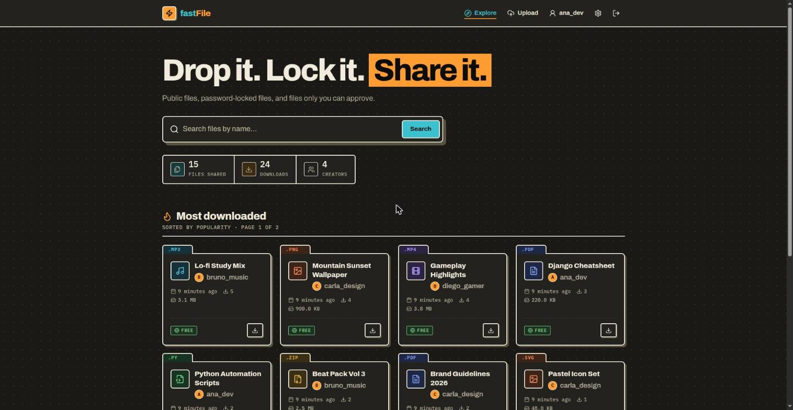
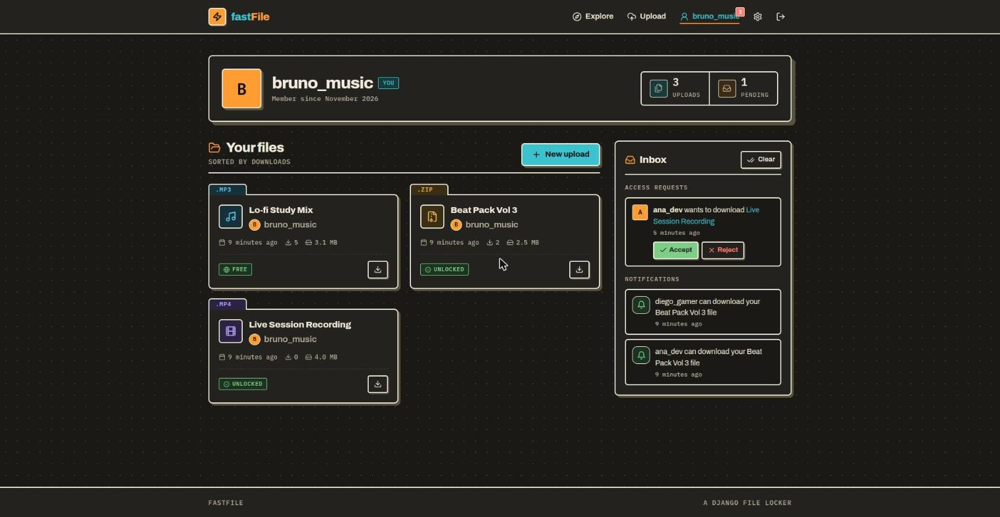
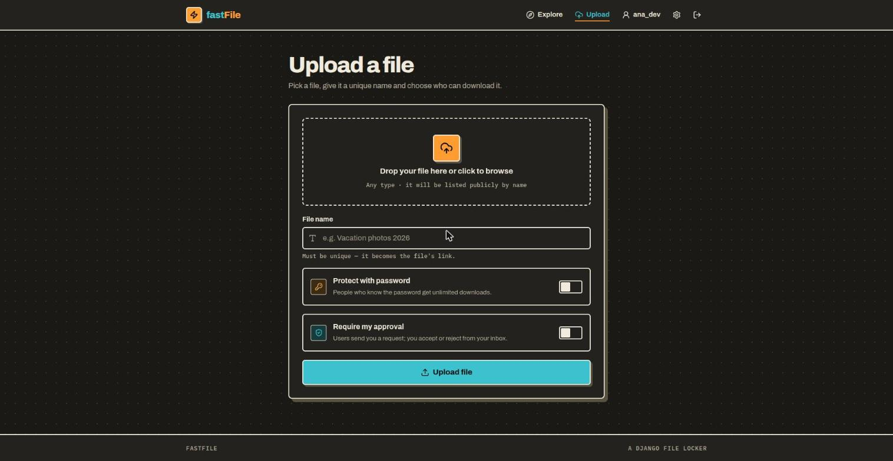

# fastFile

A "MediaFire" built with Django: anyone can browse and search files, and whoever uploads a file decides who can download it — open to everyone, behind a **password**, behind the **owner's approval**, or both.



## Features

- **Search** by file name, paginated and sorted by most downloaded.
- **Browse without logging in**: visitors see every file and can download the open ones.
- **Upload** with drag and drop and a progress bar. Each file can have:
  - a **password** — whoever gets it right gains permanent access to the file (and the owner is notified);
  - **owner approval** — the user sends a request and the owner accepts or rejects it from their inbox.
- **Profile** with the user's files and an **inbox** with access requests (accept / reject) and notifications.
- **Settings**: change username, password or email, or delete the account (which also deletes every uploaded file).
- Download counter, automatic light/dark theme and animations that respect `prefers-reduced-motion`.

## Screens

| Protected file | Profile + inbox |
|---|---|
|  |  |

| Upload | Login |
|---|---|
|  |  |

## Tech and dependencies

| What | Version |
|---|---|
| Python | 3.10+ (tested on 3.14) |
| Django | 5.2 (`requirements.txt`) |
| Database | SQLite (ships with Python) |
| Front end | Plain HTML + CSS + JavaScript, no build step |
| Icons | [Lucide](https://lucide.dev) via CDN |
| Fonts | Archivo and IBM Plex Mono via Google Fonts |

No Node, npm or anything else besides Python.

## Running it

```bash
# 1. clone
git clone https://github.com/cauekkz/fastfile.git
cd fastfile

# 2. create and activate a virtual environment
python3 -m venv .venv
source .venv/bin/activate          # Windows: .venv\Scripts\activate

# 3. install the dependencies
pip install -r requirements.txt

# 4. create the database
cd shareWeb
python manage.py migrate

# 5. (optional) fill it with demo data
python manage.py seed_demo

# 6. start the server
python manage.py runserver
```

Open **http://127.0.0.1:8000** in your browser.

To use the Django admin (`/admin`), create a superuser with `python manage.py createsuperuser`.

### Demo data

`python manage.py seed_demo` creates 4 users, 15 files of different types and a few pending access requests. You can run it as many times as you like — it never duplicates anything.

Every account uses the password **`fastfile123`**:

| User | Files |
|---|---|
| `ana_dev` | Django Cheatsheet, Portfolio Website Source *(approval)*, ... |
| `bruno_music` | Lo-fi Study Mix, Beat Pack Vol 3 *(password)*, Live Session Recording *(approval)* |
| `carla_design` | Mountain Sunset Wallpaper, Design System Kit *(password + approval)*, ... |
| `diego_gamer` | Speedrun Saves *(password)*, Gameplay Highlights, Tournament Bracket *(approval)*, ... |

Passwords for the protected files:

| File | Password |
|---|---|
| Beat Pack Vol 3 | `beats` |
| Design System Kit | `kit2026` |
| Speedrun Saves | `gg` |

> The demo files are just filler text with the right extension — they're there to test the flow, not to be opened.

## How to use

1. **Explore** — the home page lists the most downloaded files. Use the search bar to filter by name.
2. **Sign up / log in** — *Sign up* and *Log in* buttons at the top.
3. **Upload a file** — under *Upload*, drop the file in, give it a unique name and, if you want, turn on:
   - *Protect with password* to require a password;
   - *Require my approval* to require your approval.
4. **Download a protected file**
   - Password: click *Unlock* on the card (or on the file page) and type the password.
   - Approval: click *Ask* / *Ask … for access*. The owner gets the request.
5. **Approve requests** — on your profile (your name at the top), the inbox shows requests with *Accept* and *Reject* buttons. A red number at the top tells you when something new arrives.
6. **Settings** — the gear icon: change your username, password or email, or delete the account.

## Project structure

```
shareWeb/
├── manage.py
├── shareFiles/            # Django project settings
└── fastFile/              # the app
    ├── models.py          # User, File, Message, RequestMessage
    ├── views.py           # pages + APIs (/requests, /allowUser, /deleteMessages)
    ├── urls.py
    ├── util.py            # pagination and validation helpers
    ├── templatetags/      # can_download filter
    ├── management/commands/seed_demo.py
    ├── templates/fastFile/
    │   ├── layout.html
    │   ├── index.html, file.html, perfil.html, upload.html, ...
    │   └── partials/      # file grid, icons, login side panel
    └── static/fastFile/
        ├── css/app.css    # the whole design (tokens, light/dark, animations)
        └── js/            # app.js (toasts, unlock, requests), perfil.js, upload.js
```

### Routes

| Route | What it does |
|---|---|
| `/` | File list (most downloaded) |
| `/search?q=` | Search by name |
| `/file/<name>` | File page |
| `/file/<name>/download` | Download (respects password/approval) |
| `/upload` | Upload a file *(login)* |
| `/perfil/<user>` | Profile and inbox *(login)* |
| `/settings` | Account settings *(login)* |
| `/requests` | API: unlock with a password or ask for approval *(POST, JSON)* |
| `/allowUser` | API: owner accepts/rejects a request *(POST, JSON)* |
| `/deleteMessages` | API: clear notifications *(POST)* |

## Notes

- This project is meant for study and local development: `DEBUG = True` and the `SECRET_KEY` lives in `settings.py`. To deploy it, move the key to an environment variable, turn `DEBUG` off and set `ALLOWED_HOSTS`.
- Uploaded files go to `shareWeb/media/uploads/` and the database to `shareWeb/db.sqlite3` — both are in `.gitignore`.
