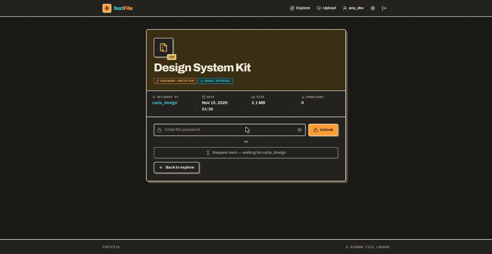
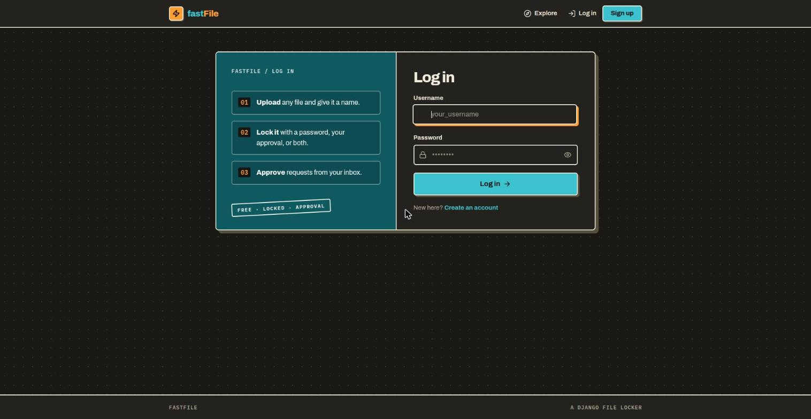

# fastFile

Um "mediafire" feito em Django: qualquer pessoa pode navegar e buscar arquivos, e quem sobe um arquivo decide quem pode baixar — livre, com **senha**, com **aprovação do dono**, ou os dois.


## Funcionalidades

- **Busca** por nome de arquivo, com paginação, ordenada pelos mais baixados.
- **Navegação sem login**: visitantes veem todos os arquivos e baixam os livres.
- **Upload** com arrastar e soltar e barra de progresso. Cada arquivo pode ter:
  - **Senha** — quem acerta a senha ganha acesso permanente ao arquivo (e o dono é notificado);
  - **Aprovação do dono** — o usuário envia um pedido e o dono aceita ou recusa pela caixa de entrada.
- **Perfil** com os arquivos do usuário e uma **caixa de entrada** com pedidos de acesso (aceitar / recusar) e notificações.
- **Configurações**: trocar nome de usuário, senha, email ou apagar a conta (apaga também os arquivos enviados).
- Contador de downloads, tema claro/escuro automático e animações que respeitam `prefers-reduced-motion`.

## Telas

| Arquivo protegido | Perfil + caixa de entrada |
|---|---|
|  |  |

| Upload | Login |
|---|---|
|  |  |

## Tecnologias e dependências

| O quê | Versão |
|---|---|
| Python | 3.10+ (testado no 3.14) |
| Django | 5.2 (`requirements.txt`) |
| Banco de dados | SQLite (já vem com o Python) |
| Front-end | HTML + CSS + JavaScript puro, sem build |
| Ícones | [Lucide](https://lucide.dev) via CDN |
| Fontes | Archivo e IBM Plex Mono via Google Fonts |

Não precisa de Node, npm nem nada além do Python.

## Como rodar

```bash
# 1. clonar
git clone https://github.com/cauekkz/midiafire-com-search-bar-feito-em-Django.git
cd midiafire-com-search-bar-feito-em-Django

# 2. criar e ativar um ambiente virtual
python3 -m venv .venv
source .venv/bin/activate          # Windows: .venv\Scripts\activate

# 3. instalar as dependências
pip install -r requirements.txt

# 4. criar o banco
cd shareWeb
python manage.py migrate

# 5. (opcional) popular com dados de demonstração
python manage.py seed_demo

# 6. subir o servidor
python manage.py runserver
```

Abra **http://127.0.0.1:8000** no navegador.

Para acessar o admin do Django (`/admin`), crie um superusuário com `python manage.py createsuperuser`.

### Dados de demonstração

O comando `python manage.py seed_demo` cria 4 usuários, 15 arquivos de tipos variados e alguns pedidos de acesso pendentes. Pode rodar quantas vezes quiser — ele não duplica nada.

Todas as contas usam a senha **`fastfile123`**:

| Usuário | Arquivos |
|---|---|
| `ana_dev` | Django Cheatsheet, Portfolio Website Source *(aprovação)*, ... |
| `bruno_music` | Lo-fi Study Mix, Beat Pack Vol 3 *(senha)*, Live Session Recording *(aprovação)* |
| `carla_design` | Mountain Sunset Wallpaper, Design System Kit *(senha + aprovação)*, ... |
| `diego_gamer` | Speedrun Saves *(senha)*, Gameplay Highlights, Tournament Bracket *(aprovação)*, ... |

Senhas dos arquivos protegidos:

| Arquivo | Senha |
|---|---|
| Beat Pack Vol 3 | `beats` |
| Design System Kit | `kit2026` |
| Speedrun Saves | `gg` |

> Os arquivos de demonstração são só texto de preenchimento com a extensão certa — servem para testar o fluxo, não para abrir.

## Como usar

1. **Explorar** — a página inicial lista os arquivos mais baixados. Use a barra de busca para filtrar pelo nome.
2. **Criar conta / entrar** — botões *Sign up* e *Log in* no topo.
3. **Enviar um arquivo** — em *Upload*, arraste o arquivo, dê um nome único e, se quiser, ative:
   - *Protect with password* para exigir senha;
   - *Require my approval* para exigir sua aprovação.
4. **Baixar um arquivo protegido**
   - Com senha: clique em *Unlock* no card (ou na página do arquivo) e digite a senha.
   - Com aprovação: clique em *Ask* / *Ask … for access*. O dono recebe o pedido.
5. **Aprovar pedidos** — no seu perfil (seu nome no topo), a caixa de entrada mostra os pedidos com os botões *Accept* e *Reject*. Um número vermelho no topo avisa quando há algo novo.
6. **Configurações** — ícone de engrenagem: trocar nome, senha, email ou apagar a conta.

## Estrutura do projeto

```
shareWeb/
├── manage.py
├── shareFiles/            # configurações do projeto Django
└── fastFile/              # o app
    ├── models.py          # User, File, Message, RequestMessage
    ├── views.py           # páginas + APIs (/requests, /allowUser, /deleteMessages)
    ├── urls.py
    ├── util.py            # paginação e validações
    ├── templatetags/      # filtro can_download
    ├── management/commands/seed_demo.py
    ├── templates/fastFile/
    │   ├── layout.html
    │   ├── index.html, file.html, perfil.html, upload.html, ...
    │   └── partials/      # grade de arquivos, ícones, painel do login
    └── static/fastFile/
        ├── css/app.css    # todo o design (tokens, claro/escuro, animações)
        └── js/            # app.js (toasts, desbloqueio, pedidos), perfil.js, upload.js
```

### Rotas

| Rota | O que faz |
|---|---|
| `/` | Lista de arquivos (mais baixados) |
| `/search?q=` | Busca por nome |
| `/file/<nome>` | Página do arquivo |
| `/file/<nome>/download` | Download (respeita senha/aprovação) |
| `/upload` | Enviar arquivo *(login)* |
| `/perfil/<usuário>` | Perfil e caixa de entrada *(login)* |
| `/settings` | Configurações da conta *(login)* |
| `/requests` | API: desbloquear com senha ou pedir aprovação *(POST, JSON)* |
| `/allowUser` | API: dono aceita/recusa um pedido *(POST, JSON)* |
| `/deleteMessages` | API: limpar notificações *(POST)* |

## Observações

- O projeto é para estudo/desenvolvimento local: `DEBUG = True` e a `SECRET_KEY` está no `settings.py`. Para colocar em produção, mova a chave para uma variável de ambiente, desligue o `DEBUG` e configure `ALLOWED_HOSTS`.
- Os arquivos enviados ficam em `shareWeb/media/uploads/` e o banco em `shareWeb/db.sqlite3` — ambos estão no `.gitignore`.
